<div align="center">


# Scripture RAG

**Answers only from the texts you load. With citations, or an honest refusal.**


[Quick start](#quick-start) | [Diagrams](#diagrams) | [How it works](#how-it-works) | [Measured results](#measured-results) | [Theme map](#unsupervised-theme-map) | [Complexity](#big-o-summary) | [Docs](#documentation)

</div>

---

Load public-domain books (PDF or TXT, including Internet Archive downloads), ask in English, Portuguese or Spanish, and get the exact passages behind each answer as `[book p.N #chunk_id]`. When the text does not support an answer the app says `I could not find this in the loaded texts.`

<p align="center">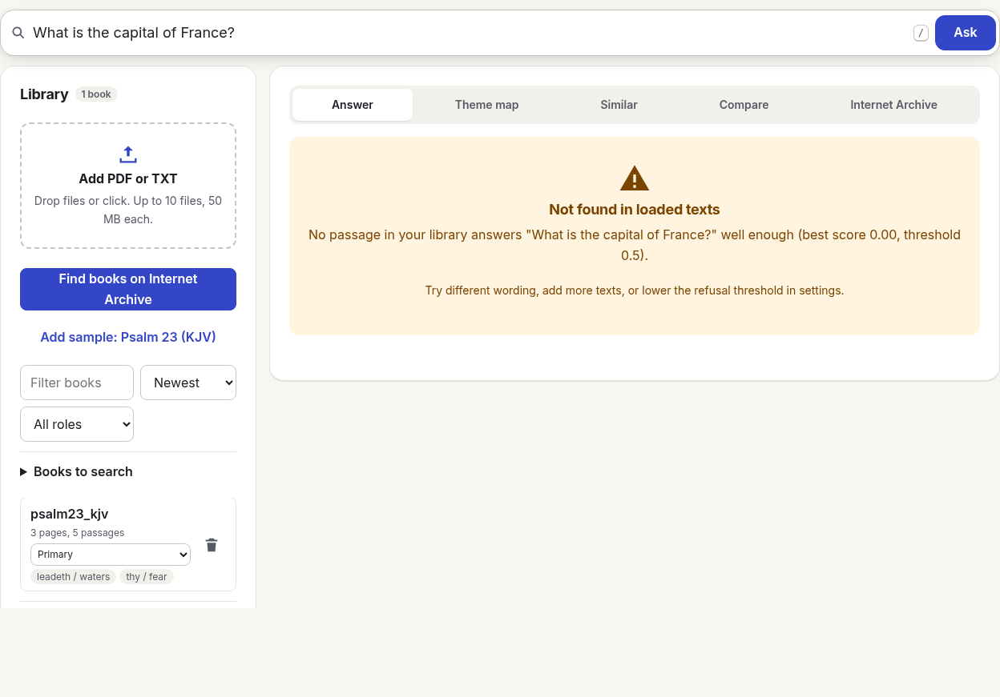</p>

## Features

| | | |
|---|---|---|
| **Hybrid retrieval**<br>BM25 plus embeddings, fused with Reciprocal Rank Fusion (k = 60) | **Reranking**<br>Lexical reranker offline, cross-encoder optional | **Citations everywhere**<br>Every sentence cites a chunk; a regex validator rejects anything else |
| **Refusal gate**<br>Low relevance means no answer and no LLM call | **Two modes**<br>`MODE=local` with Ollama, `MODE=extractive` with no LLM | **Theme map**<br>k-means, silhouette, PCA, TF-IDF topic labels, optional BERTopic |
| **Similar passages**<br>Nearest neighbors from other books | **Browser demo**<br>Runs fully client side, history in IndexedDB | **Safe uploads**<br>Magic bytes, size and page caps, parse timeout, escaped output |
| **Compare mode**<br>Same question answered per tradition, side by side | **Outlier flags**<br>Passages far from every cluster are marked on the theme map | **Library manifest**<br>Books, roles, traditions and licenses, exportable as CSV or JSON |

### Feature notes

- **Internet Archive panel.** Search archive.org with client-side year, author, collection and public-domain filters; each hit shows a license label. Hits are clustered (k-means, K by silhouette, up to 5) with the active embedder and ranked by similarity to the centroid of the loaded library, so related books surface first. For any item, `licenseurl`, `rights`, `possible-copyright-status` and dates are shown before anything downloads. PDFs are parsed page by page (pypdf in Python, pdf.js in the browser) so every chunk keeps `page_start`/`page_end`.
- **Book selector.** Choose which loaded books an answer may search; retrieval then runs on that subset only (subset BM25 plus filtered vectors).
- **Hybrid retrieval.** BM25 (exact words, names, verse references) and `multilingual-e5-small` embeddings (meaning, cross-language) each return candidates; Reciprocal Rank Fusion merges the two rankings without score calibration. A cross-encoder reranker orders the final top 5.
- **Support gate.** If the best reranked passage scores below the calibrated threshold (0.22 for the e5 + mMiniLM pair, see [stress results](docs/eval/stress_results.md)), the app refuses instead of answering, and no generator runs. A validator also refuses any draft whose citations do not resolve to supplied chunks.
- **History.** Every question, answer and citation is stored in IndexedDB (`scripture-rag` database) with search, re-open, export/import JSON and clear all. Nothing leaves the browser.
- **Theme map.** k-means (K by silhouette) on passage embeddings, PCA to 2D, class-based TF-IDF labels. Re-clusters when books change; click a point for nearest passages from other books.
- **Compare mode.** Asks the same question once per group (tradition by default, or per book or role); each group's answer cites only its own books and can refuse independently.
- **Outlier flags.** Passages whose distance to their cluster centroid has a z-score above 2.5 are flagged, which tends to surface OCR noise, front matter and indexes.
- **Library manifest.** One row per loaded book: id, title, role, tradition, date, source URL, license status, pages, passages, added date; export to CSV or JSON for audit.

## Quick start

### Windows (PowerShell)

```powershell
# Python 3.11 from python.org, then:
git clone https://github.com/IgorCSIS/scripture-rag.git
cd scripture-rag
py -3.11 -m venv .venv
.\.venv\Scripts\Activate.ps1
pip install -r requirements-dev.txt -e .
copy .env.example .env

# Tests and the command line demo (uses the small public-domain test fixtures)
python -m pytest
python demo.py --corpus tests\fixtures\books

# Local app at http://127.0.0.1:7860
python app_gradio.py
```

Optional real models and local generation:

```powershell
pip install -r requirements-models.txt          # sentence-transformers, BERTopic (downloads torch)
nvidia-smi                                       # check VRAM: 8 GB fits qwen2.5:7b, 6 GB use llama3.2:3b
# Install Ollama for Windows from https://ollama.com, then:
ollama pull qwen2.5:7b
ollama pull llama3.2:3b
# In .env: MODE=local, EMBED_MODEL=intfloat/multilingual-e5-small, RERANK_MODEL=cross-encoder/ms-marco-MiniLM-L-6-v2
python app_gradio.py
```

`make` is optional on Windows; every Makefile target is a single `python ...` command shown above.

### macOS / Linux

```bash
python3.11 -m venv .venv && source .venv/bin/activate
make install && make test
make demo CORPUS=tests/fixtures/books
make app
```

### Run the hosted demo (extractive)

```bash
streamlit run app_streamlit.py
```

On Streamlit Community Cloud, point a new app at `app_streamlit.py`; keep `EMBED_MODEL=hashing` or a small model to stay under the 2.7 GB memory cap. No secrets are needed. Not deployed yet.

### Browser demo

```bash
python -m http.server 8000 --directory site   # then open http://localhost:8000
```

Everything stays in your browser: libraries (chunks plus embeddings) and the Q&A history live in IndexedDB, with search, re-open, export/import JSON and clear all. Switch embeddings to `multilingual-e5-small` to download the model once from Hugging Face.

## Diagrams

<p align="center">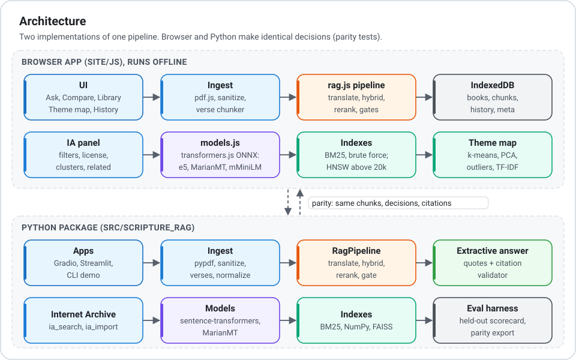</p>
<p align="center">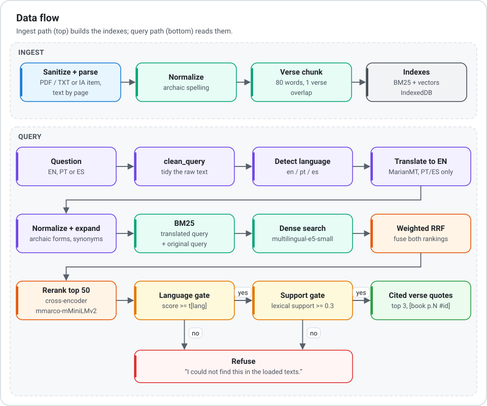</p>
<p align="center">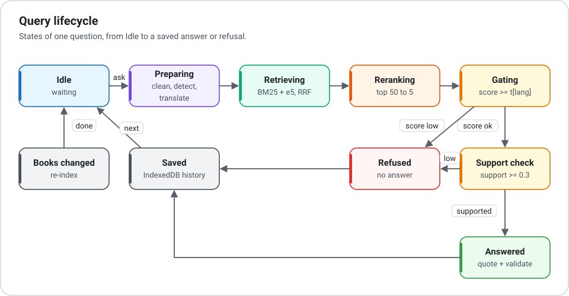</p>

Mermaid versions of all required diagrams (user story map, use case, architecture, sequence, data flow, ERD, state, class, GUI mockup) are in [docs/ARCHITECTURE.md](docs/ARCHITECTURE.md).

## How it works

<p align="center">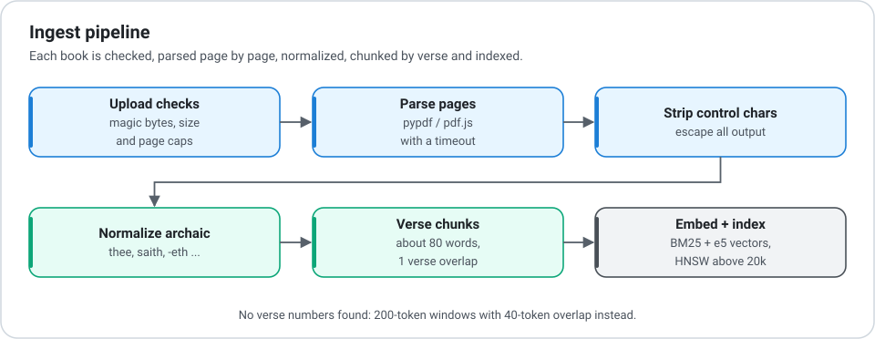</p>
<p align="center">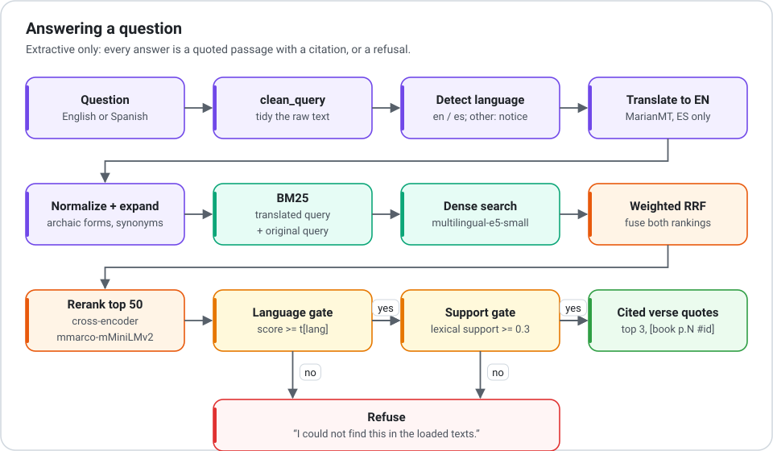</p>

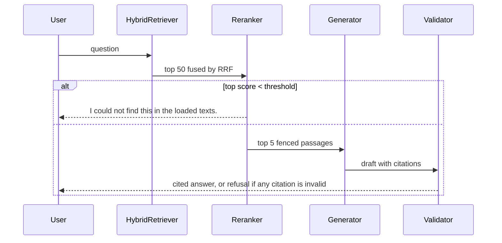

<p align="center">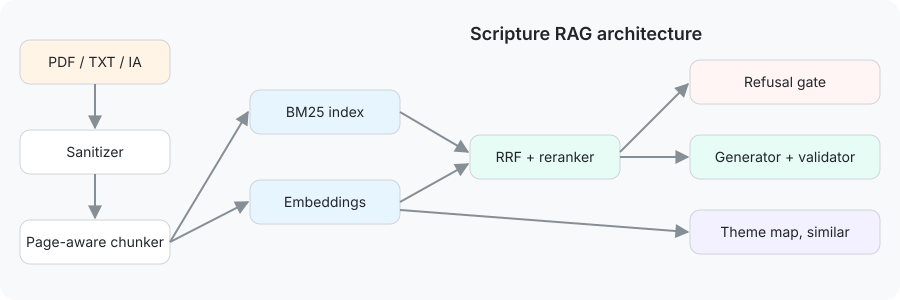</p>

All required diagrams (user story map, use case, architecture, sequence, data flow, ERD, state, class, GUI mockup) are in [docs/ARCHITECTURE.md](docs/ARCHITECTURE.md).

## Unsupervised theme map

<p align="center">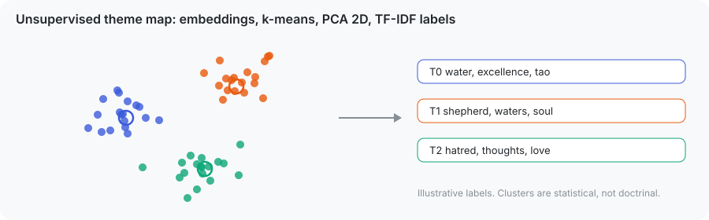</p>
<p align="center">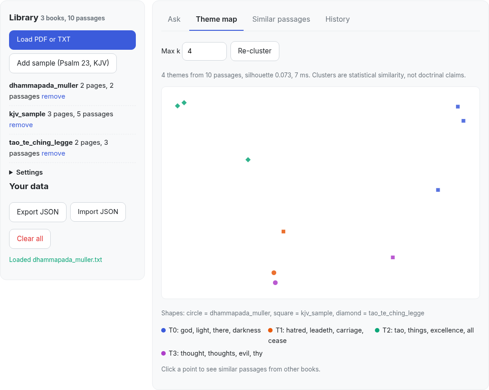</p>

Passage embeddings are clustered with k-means (K chosen by silhouette), projected to 2D with PCA and labeled with class-based TF-IDF keywords. The map re-clusters as books are added; clicking a point lists the most similar passages from other books. Clusters are statistical similarity, not doctrinal claims.

## Big-O summary

n = chunks, d = embedding dim, k = candidates, K = clusters, i = iterations, L = chunk tokens, q = query tokens, N = characters.

| Operation | Time | Measured slope |
|---|---|---|
| Chunking | O(N) | 0.95 |
| Brute-force search | O(n d + n log k) | 0.92 |
| HNSW search | about O(d log n) | 0.42 |
| BM25 query | O(postings), O(n q) in rank_bm25 | 1.15 |
| RRF | O(k log k) | |
| Cross-encoder rerank | O(k (q+L)^2 d) | |
| k-means | O(n K i d) | 0.63 |
| PCA to 2D | O(n d^2) | -0.04 (solver switching, see docs) |

<p align="center">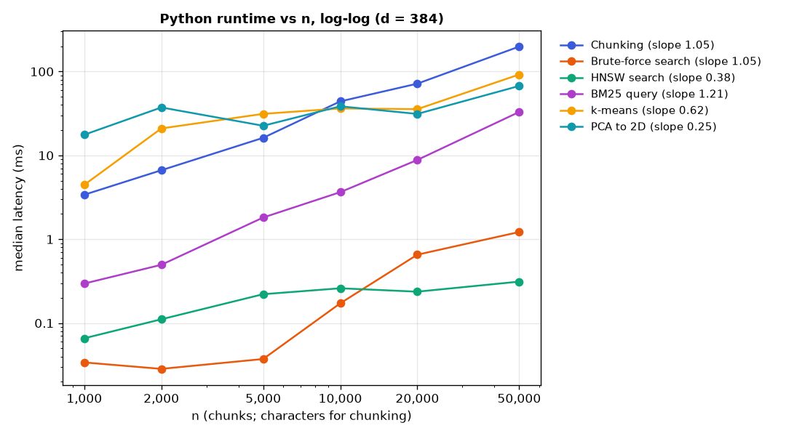</p>

<p align="center">
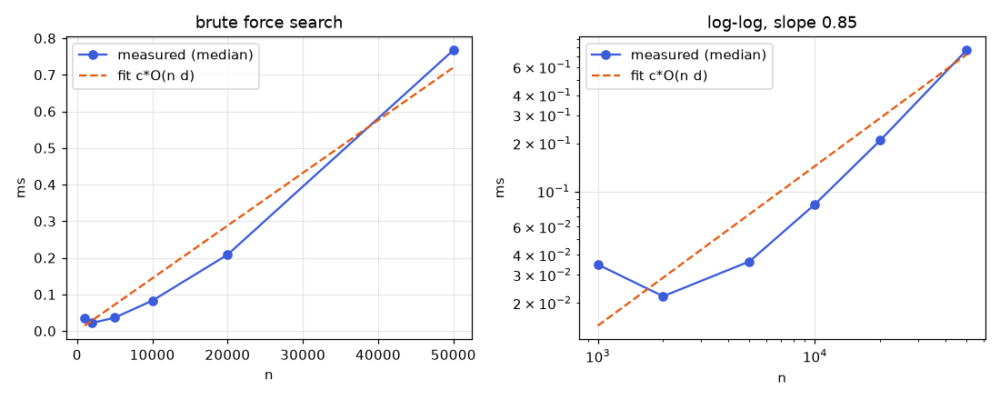
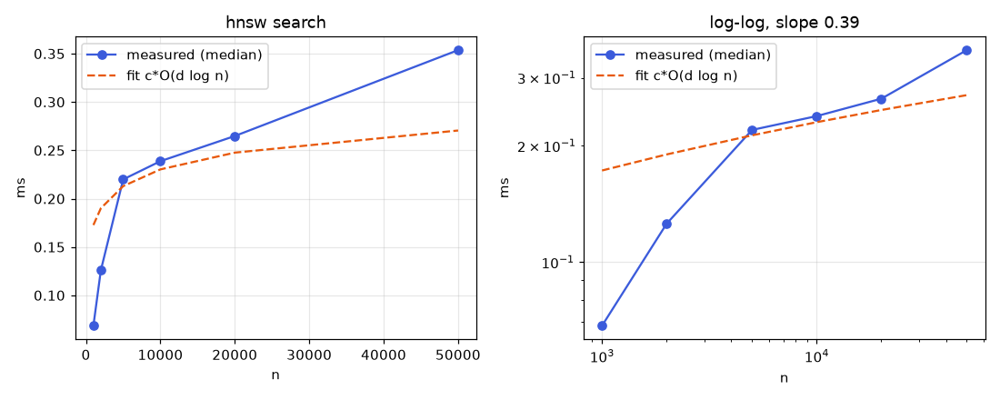
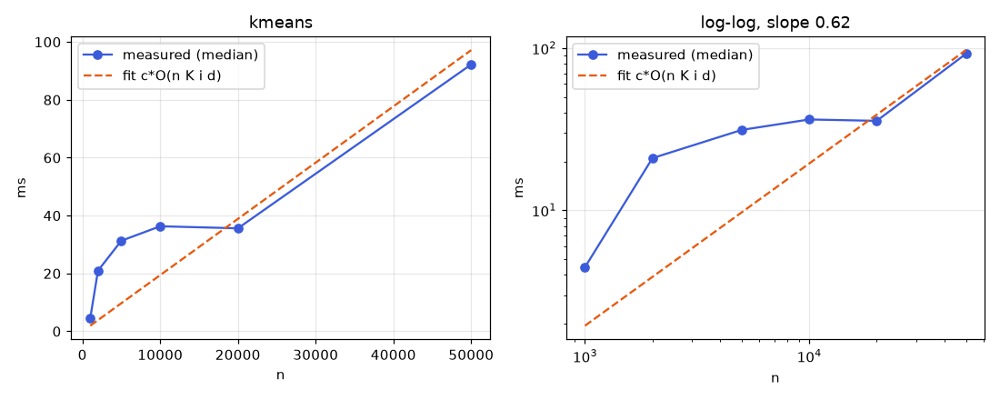
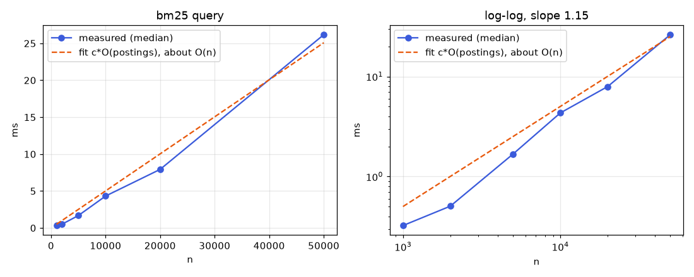
</p>

Full table, theory (curse of dimensionality, NP-hardness of k-means, refusal as a decision problem, citations as a regular language, rank aggregation) and discussion: [docs/COMPLEXITY.md](docs/COMPLEXITY.md). Regenerate with `python bench/bench_complexity.py`.

## Evaluation

`python -m scripture_rag.eval --corpus tests/fixtures/books --gold tests/fixtures/gold_fixture.jsonl`

| Metric (fixture smoke set, 12 items) | Value |
|---|---|
| Recall@10 vector / BM25 / hybrid / hybrid+rerank | 1.00 / 1.00 / 1.00 / 1.00 |
| Answer rate (answerable) | 1.00 |
| Refusal recall (unanswerable) | 1.00 |

The fixture corpus is tiny, so these numbers validate the harness rather than quality. Real-book results are under [Measured results](#measured-results). See [docs/EVALUATION.md](docs/EVALUATION.md).

## Measured results

All numbers below are copied from files committed in the repo. Nothing is estimated.

### PDF stress test ([docs/eval/stress_results.md](docs/eval/stress_results.md))

Two Internet Archive books (KJV 1611 reprint, Rodwell Koran), `multilingual-e5-small` + `mmarco-mMiniLMv2-L12-H384-v1`, threshold 0.22, 81 items.

| Metric | Value |
|---|---|
| Overall pass rate | 0.765 |
| Answer accuracy (en / pt / es) | 0.682 (0.75 / 0.667 / 0.333) |
| Citation validity | 1.0 |
| Refusal recall / precision | 0.929 / 0.906 |
| False refusals on answerable | 3 |
| Trick / injection pass rate | 0.667 / 0.667 |
| Latency p50 | 1972 ms |

### Grounding: source not loaded vs loaded ([docs/eval/loaded_phase_results.md](docs/eval/loaded_phase_results.md))

| Condition | Pass | Answered | Abstained |
|---|---|---|---|
| Source not loaded | 11/13 | 2 | 11 |
| Source loaded | 11/13 | 9 | 4 |

### Browser ANN ([docs/benchmarks/browser_ann.json](docs/benchmarks/browser_ann.json))

| n | Brute p50 ms | HNSW p50 ms | HNSW build s | HNSW recall@10 |
|---|---|---|---|---|
| 1,000 | 0.63 | 0.42 | 0.97 | 1.00 |
| 5,000 | 3.10 | 0.27 | 3.92 | 0.85 |
| 20,000 | 15.42 | 0.78 | 20.82 | 0.79 |
| 50,000 | 47.02 | 1.29 | 73.28 | 0.94 |

### Browser library stages, ms ([docs/benchmarks/library_stages.json](docs/benchmarks/library_stages.json))

| Stage | n=500 | 1,000 | 2,000 | 4,000 | 8,000 |
|---|---|---|---|---|---|
| Outliers | 14.57 | 23.27 | 15.90 | 19.09 | 62.57 |
| Auto-tags | 0.16 | 0.07 | 0.12 | 0.24 | 0.53 |
| Manifest CSV | 0.06 | 0.12 | 0.08 | 0.16 | 0.32 |
| Role-scoped answer | 13.77 | 11.37 | 23.40 | 24.84 | 89.91 |
| Compare by tradition | 22.92 | 23.48 | 24.97 | 34.66 | 137.83 |

<p align="center">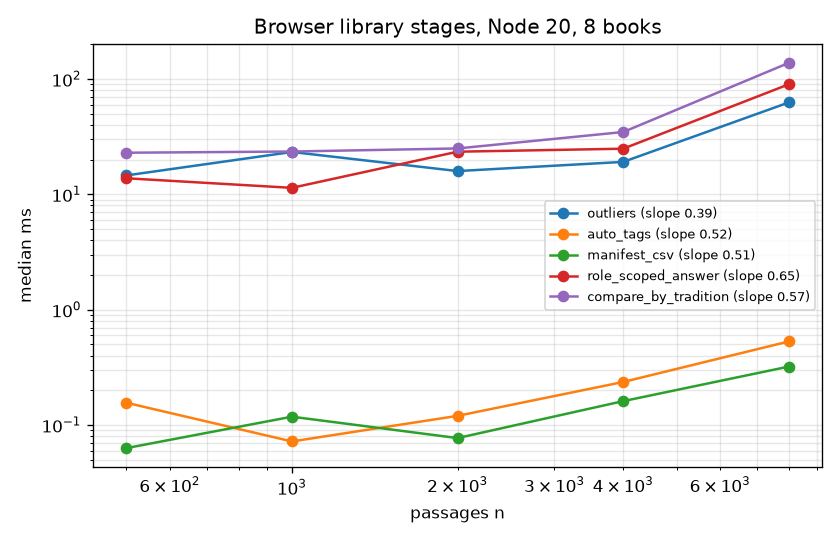 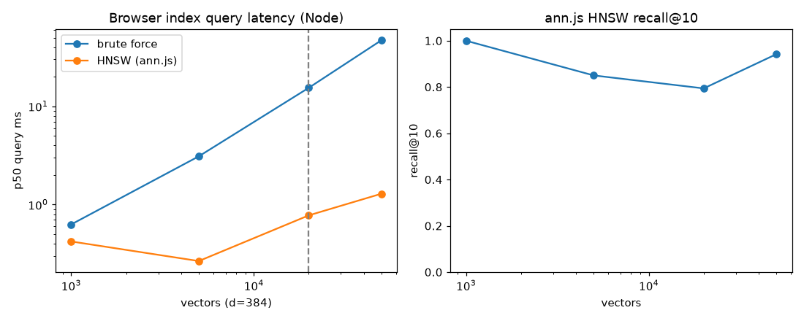</p>

> **TODO (benchmarks worker):** no measured benchmark yet for the IA panel stages (`filterHits`, `clusterHits`, `rankRelated`). Their predicted costs are in [docs/COMPLEXITY.md](docs/COMPLEXITY.md#internet-archive-panel-filters-book-selector-result-clustering). Embed the graph here once `docs/benchmarks/` has it.

Server-side vector store comparison (NumPy, FAISS Flat/HNSW/IVF, LanceDB, Chroma): [docs/VECTOR_DB.md](docs/VECTOR_DB.md), raw data in [docs/benchmarks/vectordb.json](docs/benchmarks/vectordb.json).

### Final scorecard

> **PLACEHOLDER, owned by the eval worker. Do not fill by hand.** Values come from the final run of the full gold set in [docs/eval/eval_set.jsonl](docs/eval/eval_set.jsonl).

| Metric | Value |
|---|---|
| Items | `TBD (eval worker)` |
| Recall@10 hybrid + rerank | `TBD (eval worker)` |
| Answer accuracy (en / pt / es) | `TBD (eval worker)` |
| Citation validity | `TBD (eval worker)` |
| Refusal recall / precision | `TBD (eval worker)` |
| Latency p50 / p95 | `TBD (eval worker)` |

## Limitations

- OCR noise in scanned Internet Archive books affects retrieval; scanned PDFs without a text layer yield no text.
- Citations use the PDF page index, which can differ from the printed page number.
- A chunk spanning two pages is cited by its first page; the Sources view shows the full range.
- The default offline embedder and reranker match words, not meaning; use the real models for semantic and cross-language questions. The refusal threshold must be calibrated per model.
- Clusters are statistical, not doctrinal.

## Project layout

```
src/scripture_rag/   config, sanitize, ingest, chunker, embed, index, bm25, hybrid, rerank,
                     generate, validate, pipeline, topics, similar, ia_import, eval, corpus
app_gradio.py        local app (Ollama optional)
app_streamlit.py     extractive demo
demo.py              command line demo
bench/               complexity benchmarks
site/                static website and browser demo (js/core.js, js/db.js, js/app.js)
tests/               pytest suite and public-domain fixtures
docs/                PRD, architecture, complexity, evaluation, security, sources, progress
```

## Documentation

| Document | Contents |
|---|---|
| [docs/PRD.md](docs/PRD.md) | Requirements FR-01 to FR-16 with acceptance criteria and evidence |
| [docs/ARCHITECTURE.md](docs/ARCHITECTURE.md) | All mermaid diagrams |
| [docs/COMPLEXITY.md](docs/COMPLEXITY.md) | Big-O table, computational theory, benchmark plots |
| [docs/COURSE_MAPPING.md](docs/COURSE_MAPPING.md) | Feature to course module mapping |
| [docs/EVALUATION.md](docs/EVALUATION.md) | Eval harness and smoke results |
| [docs/eval/](docs/eval/) | Stress and grounding eval sets and results |
| [docs/benchmarks/](docs/benchmarks/) | Benchmark JSON and PNGs |
| [docs/VECTOR_DB.md](docs/VECTOR_DB.md) | Vector index choice |
| [docs/SECURITY.md](docs/SECURITY.md) | Uploads, prompt injection, storage, secrets |
| [docs/DATA_SOURCES.md](docs/DATA_SOURCES.md) | Text and model license evidence |
| [docs/PROGRESS.md](docs/PROGRESS.md) | Phase progress log |
| [docs/LAUNCH_CHECKLIST.md](docs/LAUNCH_CHECKLIST.md) | Steps to go public and enable Pages |

Every `.md` file in the repo:

```
README.md
DEVELOPMENT.md
CONTRIBUTING.md
data/demo/README.md
data/gold/README.md
docs/PRD.md
docs/ARCHITECTURE.md
docs/COMPLEXITY.md
docs/COURSE_MAPPING.md
docs/DATA_SOURCES.md
docs/EVALUATION.md
docs/LAUNCH_CHECKLIST.md
docs/PROGRESS.md
docs/SECURITY.md
docs/VECTOR_DB.md
docs/eval/loaded_phase_results.md
docs/eval/stress_results.md
```

## License

MIT, see [LICENSE](LICENSE). Bundled sample texts are public domain; see [docs/DATA_SOURCES.md](docs/DATA_SOURCES.md).
