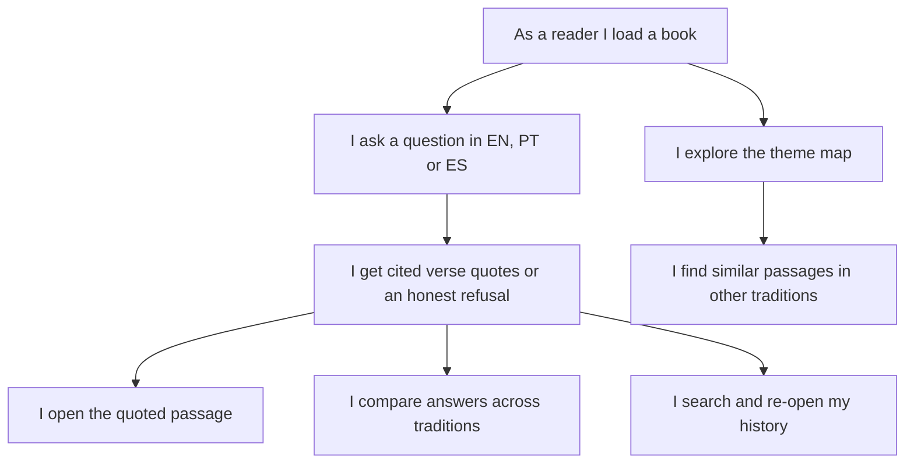
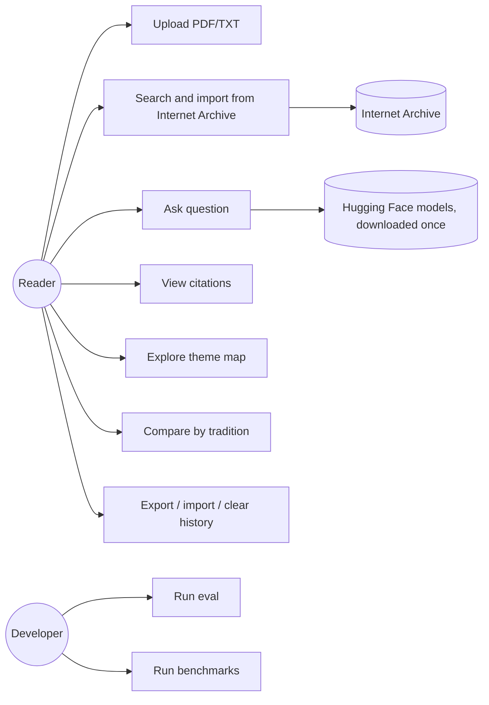
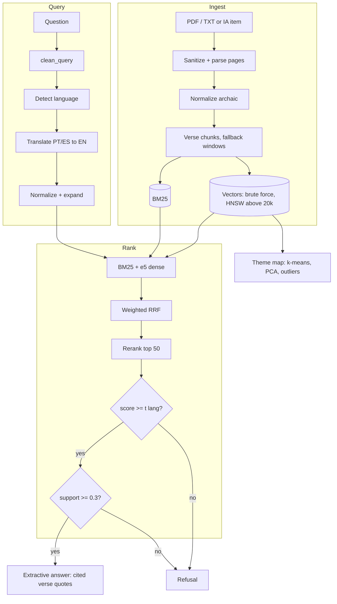
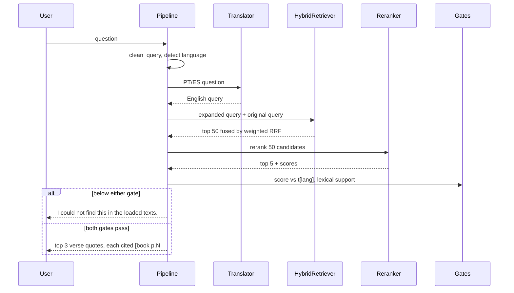
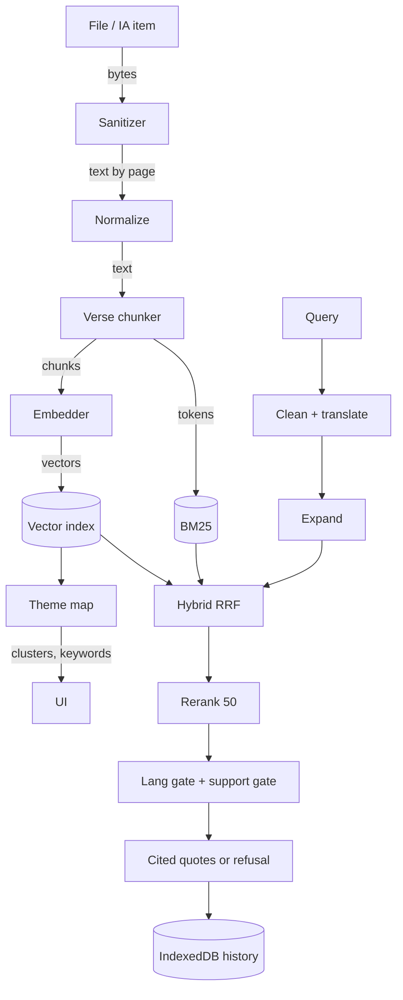
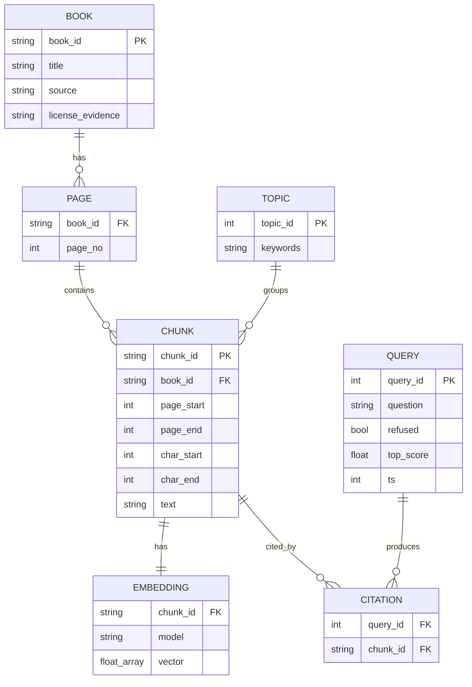
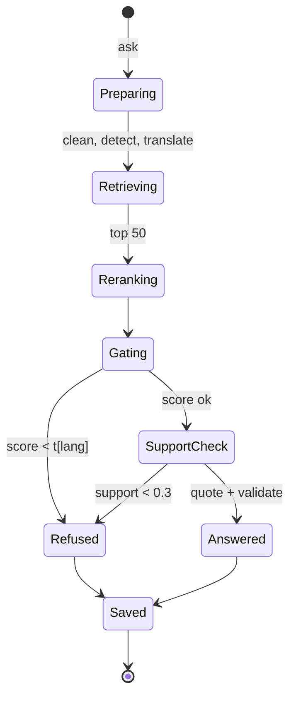
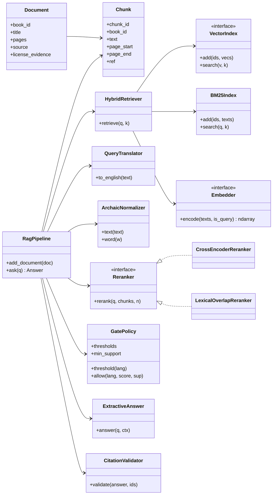
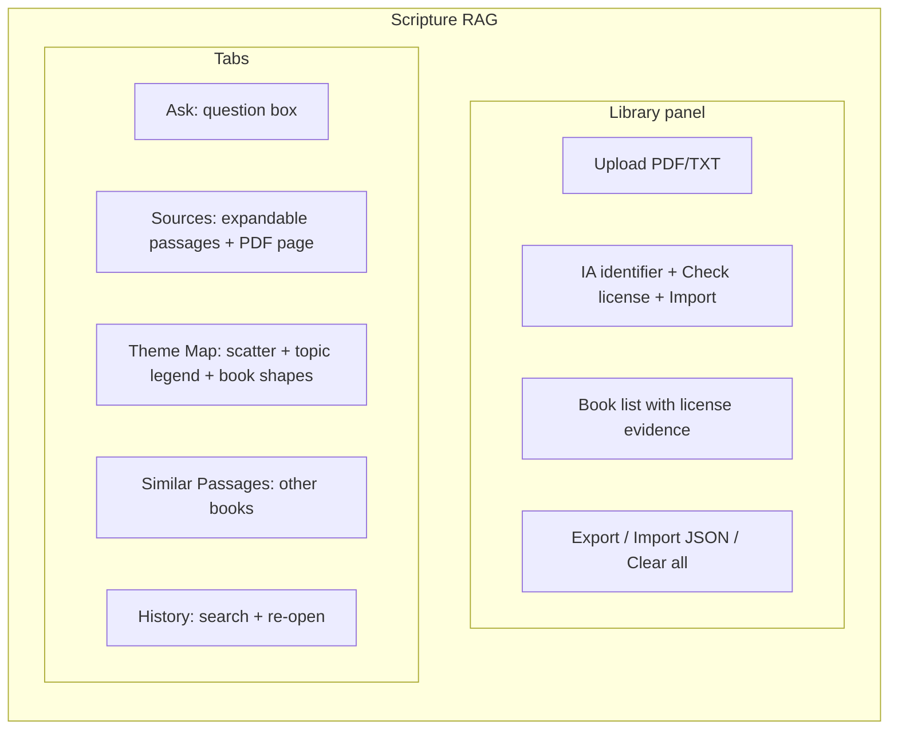

# Architecture

Answers are extractive: every answer is a set of quoted verses with citations, or a refusal. There is no LLM or text generation step anywhere in the pipeline.

Modules (`src/scripture_rag/`): `config` (env settings), `sanitize` (upload checks), `ingest` (PDF/TXT to pages), `verses` (verse parsing and verse chunks), `chunker` (fallback token windows), `normalize` (archaic normalization and query expansion), `text_utils` (tokenizer, `clean_query`), `translate` (language detection, PT/ES to EN MarianMT), `embed`, `index` (brute force, FAISS HNSW, LanceDB), `bm25`, `hybrid` (weighted RRF), `rerank` (cross-encoder, lexical fallback), `gate` (per-language score gate, lexical support), `generate` (extractive answer builder), `validate` (citation check), `pipeline` (ask flow), `topics`, `similar`, `library` (manifest), `ia_search`, `ia_import`, `discover`, `pdfgen`, `eval`, `corpus`.

The browser app (`site/js/`) runs the same pipeline with the same defaults: `rag.js` (pipeline), `models.js` (transformers.js models), `ann.js` (HNSW above 20k passages), `core.js` (BM25, k-means, PCA, TF-IDF labels), `library.js` (manifest, roles, compare), `ia.js` and `archive-ui.js` (Internet Archive panel), `db.js` (IndexedDB), `app.js` and `ui.js` (UI). Browser and Python make identical answer/refuse decisions and citations on the eval set ([docs/eval/parity.json](eval/parity.json)).

## User story map

## Use case

## Architecture

## Sequence (ask, with refusal branch)

## Data flow

## ERD

In the browser, IndexedDB stores `books` (BOOK), `chunks` (CHUNK with its EMBEDDING inline), `history` (QUERY with CITATION list inline) and `meta`. In Python, data lives in memory (`RagPipeline.documents`, `chunks`, `BruteForceIndex`); `LanceDBIndex` is the on-disk option. Topics are computed on demand.

## State (query lifecycle)

## Class

## GUI mockup

## Diagrams as SVG
`docs/diagrams/architecture.svg`, `data_flow.svg`, `state.svg` and `site/assets/pipeline.svg`, `retrieval.svg`, `clustering.svg`, `architecture.svg` share one style (system font stack, rounded cards on a light panel that stays readable on light and dark backgrounds). They are used in the README and on the website.
