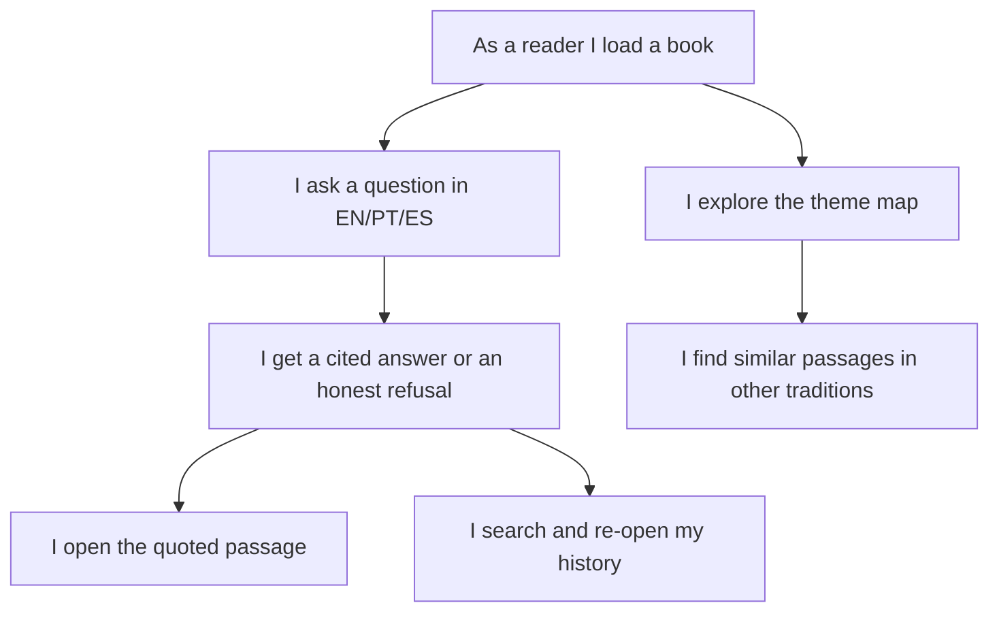
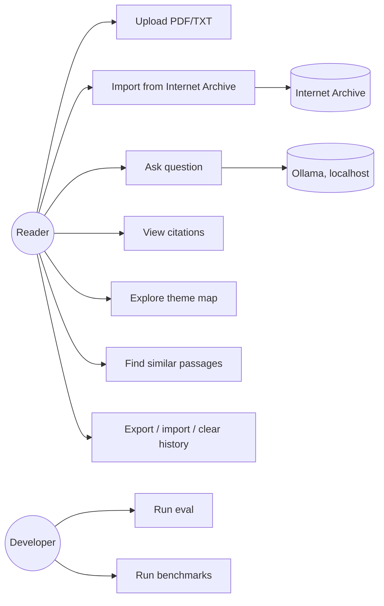
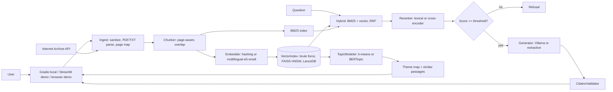
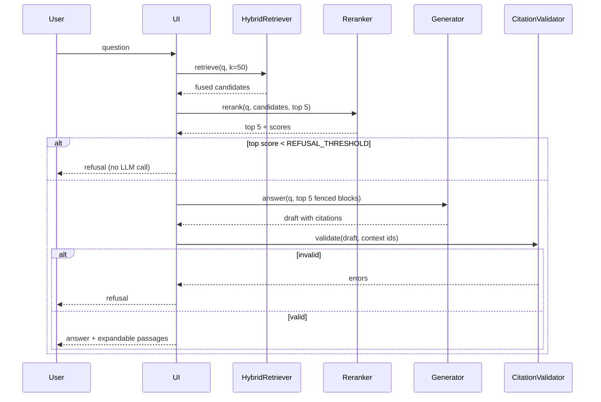
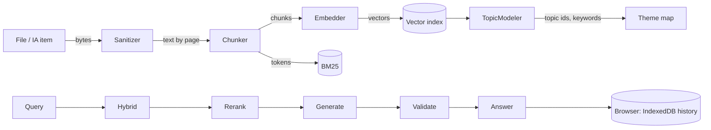
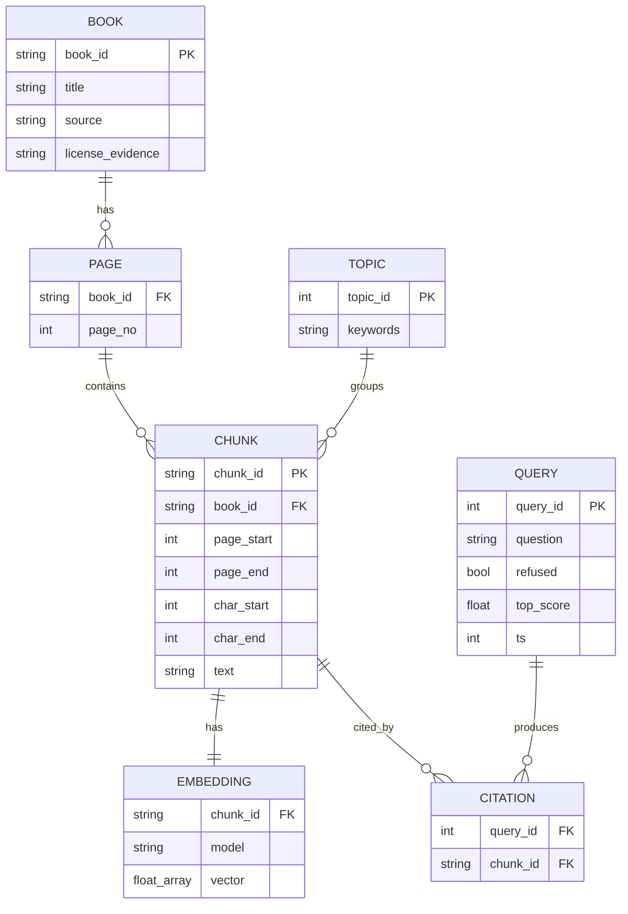
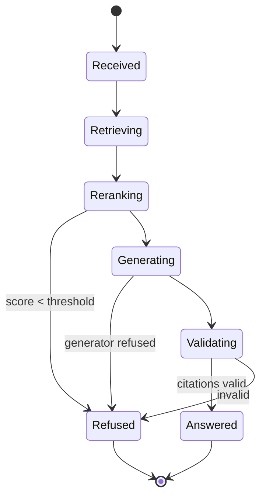
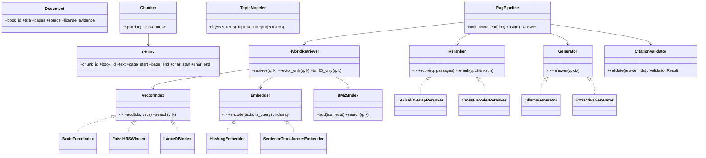
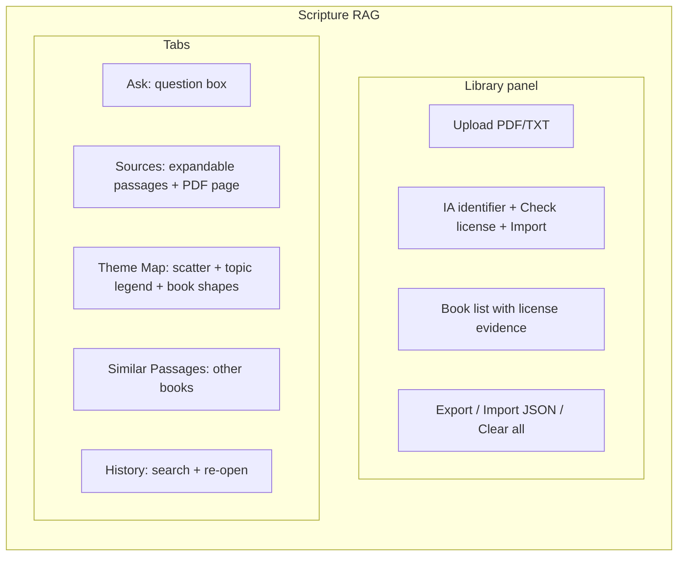

# Architecture

Modules (`src/scripture_rag/`): `config` (env settings), `sanitize` (upload checks), `ingest` (PDF/TXT to pages), `chunker`, `embed` (Embedder interface, hashing and sentence-transformers), `index` (VectorIndex: brute force, FAISS HNSW, LanceDB), `bm25`, `hybrid` (RRF), `rerank`, `generate` (Generator interface: Ollama, extractive), `validate` (citation regex), `pipeline` (ask flow), `topics`, `similar`, `ia_import`, `eval`, `corpus`.

The browser demo (`site/js/`) reimplements the same pipeline in JavaScript: `core.js` (chunker, BM25, RRF, coverage reranker, k-means, PCA, TF-IDF labels, similar passages), `db.js` (IndexedDB), `app.js` (UI).

## User story map

## Use case

## Architecture

## Sequence (ask, with refusal branch)

## Data flow

## ERD

In the browser, IndexedDB stores `books` (BOOK), `chunks` (CHUNK with its EMBEDDING inline), `history` (QUERY with CITATION list inline) and `meta`. In Python, data lives in memory (`RagPipeline.documents`, `chunks`, `BruteForceIndex`); `LanceDBIndex` is the on-disk option. Topics are computed on demand.

## State (query lifecycle)

## Class

## GUI mockup

## Diagrams as SVG
`site/assets/pipeline.svg`, `retrieval.svg`, `clustering.svg`, `architecture.svg` are hand-written SVG versions used in the README and the website.
