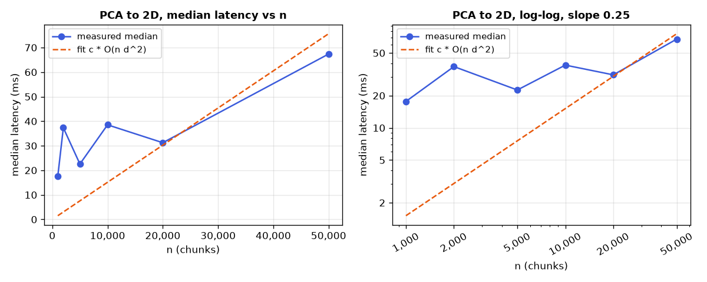
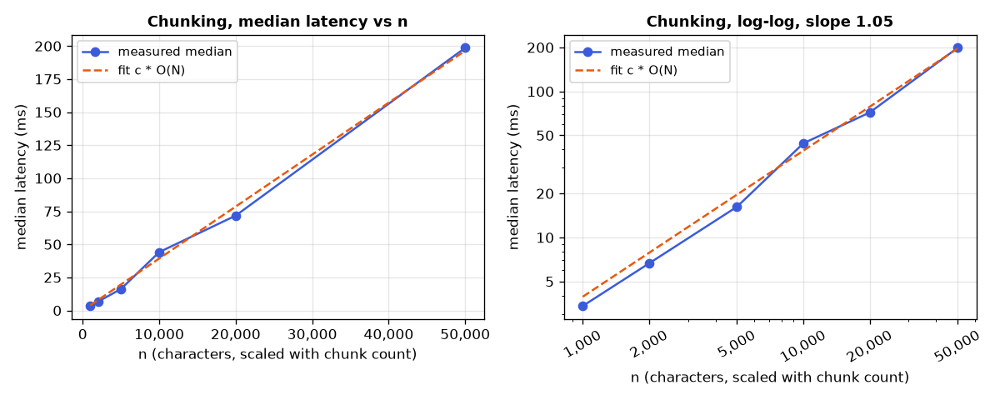
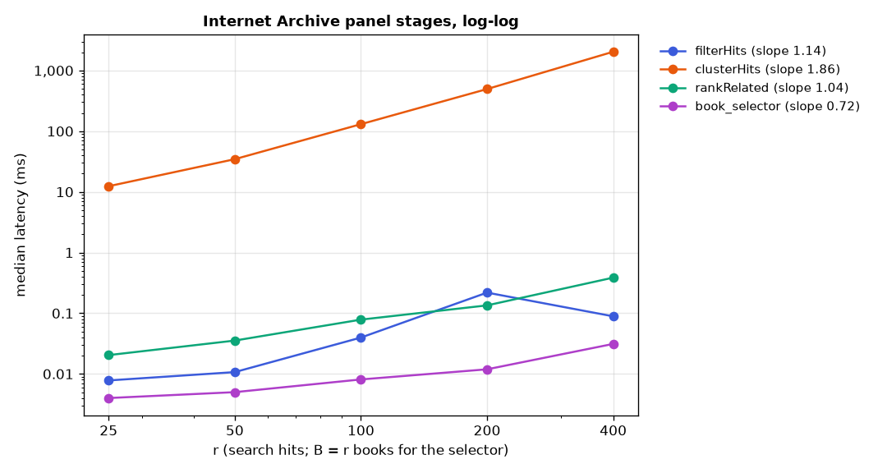

# Complexity, theory and benchmarks

## Symbols
N = total characters in a book; n = number of chunks (or vectors); d = embedding dimension; L = tokens per chunk; q = query tokens; k = candidates kept; K = clusters; i = iterations; V = vocabulary size; M = HNSW neighbors per node; s = silhouette sample size; H = history entries; B = number of books.

## Big-O table

| Operation | Time | Space | Notes |
|---|---|---|---|
| Parse PDF/TXT | O(N) | O(N) | Linear scan per page |
| Chunking (sliding window) | O(N) | O(N) | Each token visited a constant number of times (overlap ratio fixed) |
| Embedding (transformer) | O(n L^2 d) | O(n d) stored | Attention is quadratic in L; L is capped, so linear in n |
| Hashing embedder | O(N) | O(n d) | One hash per token |
| Flat index build | O(n d) | O(n d) | Store unit vectors |
| HNSW build | about O(n log n d) | O(n d + n M) | Expected, not worst case |
| Brute-force search | O(n d + n log k) | O(n) | Python uses argpartition, O(n d + n + k log k); browser uses a size k heap |
| HNSW search | about O(d log n) | O(ef) | Approximate, recall < 1 |
| BM25 build | O(total tokens) | O(V + postings) | Inverted index (browser); rank_bm25 keeps term counts per doc |
| BM25 query | O(sum of postings of q terms) | O(n) scores | Browser touches only postings; rank_bm25 is O(n q) |
| RRF fuse | O(k log k) | O(k) | Hash map plus sort |
| Rerank, lexical | O(k (q + L)) | O(k) | Set intersection |
| Rerank, cross-encoder | O(k (q+L)^2 d) | O(k) | Dominant query cost; keep k about 20 to 50 |
| Citation validation | O(length of answer) | O(1) | One DFA pass (regex) |
| k-means (Lloyd) | O(n K i d) | O(n + K d) | Plus k-means++ init O(n K d) |
| Choosing K by silhouette | O(sum over K of (n K i d + s n d)) | O(n) | Browser samples s <= 300 points |
| PCA to 2D | O(n d^2 + d^3) full, O(n d i) power iteration | O(n d) | sklearn chooses the solver by shape; browser uses power iteration |
| TF-IDF labels | O(total tokens + K V) | O(K V) | Class-based TF-IDF |
| HDBSCAN (BERTopic) | O(n log n) average to O(n^2) worst | O(n) | Depends on data and implementation |
| UMAP (BERTopic) | about O(n^1.14) empirically | O(n) | UNVERIFIED this session |
| Similar passages | O(n d + n log k) | O(n) | Brute force filtered by book |
| IndexedDB save book | O(n) writes | O(n d) | One transaction |
| IndexedDB load all | O(n d + H) | O(n d + H) | Rebuilds BM25 in O(total tokens) |
| History search | O(H x text length) | O(H) | Linear filter, fine for H in the hundreds |
| Export / import JSON | O(n d + H) | O(n d + H) | Vectors serialized as arrays |
| Verse parsing, numbered (`parse_numbered`) | O(N) | O(N) | One regex pass; book changes detected when chapter 1:1 recurs |
| Sura parsing (`parse_suras`) | O(N) | O(N) | Line scan, heading regex, resync on printed verse multiples of 5 |
| Reference alignment (`ReferenceAligner`) | O(S (c + w)) | O(R w) inverted index | S source sentences, R reference verses, c candidate verses touched via rare-term postings, w words per verse; monotonic prior keeps c small |
| Verse chunking | O(number of verses) | O(N) | Greedy packing to about 80 words, 1 verse overlap |
| Archaic normalization | O(N) | O(V) | Table lookups plus suffix rules per token |
| Query translation (MarianMT) | O(T q d) | model weights | Only for PT/ES questions; cached per question |
| Weighted RRF over 3 lists | O(k log k) | O(k) | BM25, dense(original), dense(English) |
| Lexical support check | O(q + L) | O(V) IDF table | IDF built once per index change in O(total tokens) |
| Gate policy | O(1) | O(languages) | Per-language threshold plus minimum support |
| IA search request | O(1) client work plus network | O(rows) | 1 request per second, backoff 2^a seconds or Retry-After, LRU cache with TTL |
| IA import | O(file size) | O(file size) | Size checked from metadata before download; capped stream read in the browser |
| Hit clustering (TF-IDF k-means) | O(h K i V_h) | O(h V_h) | h hits (at most 100), sparse vectors |
| Library centroid and related ranking | O(n d + h d) | O(d) | Mean of chunk vectors, cosine per hit |
| Book auto-tags | O(n K) | O(B K) | Majority topic per book from cluster labels |
| Outliers (z-score of centroid distance) | O(n d) | O(n) | Per-cluster mean and std of distances |
| Compare by book or tradition | O(G (retrieval + rerank)) | O(G k) | G groups, one filtered query each |
| Manifest export | O(B) | O(B) | JSON or CSV |
| Browser HNSW (`ann.js`) build | expected O(n log n M d) | O(n (d + M)) | Built lazily, incrementally, when n > 20000 |
| Browser HNSW query | expected O(ef M d log n) | O(ef) | ef = 64 |

## Browser storage layout (IndexedDB `scripture-rag`, version 1)

| Store | Key | Value | Index |
|---|---|---|---|
| books | bookId | {bookId, title, pages, addedAt} | none |
| chunks | chunkId | {chunkId, bookId, text, pageStart, pageEnd, vec: Float32Array} | bookId |
| history | id (auto) | {ts, question, refused, topScore, citations: [{chunkId, bookId, pageStart, pageEnd, text}]} | ts |
| meta | k | {k: "embedder", v} | none |

Citations are copied into each history entry so re-opening an answer still works after its book is removed (space O(H k L) traded for O(1) re-open). Deleting a book uses the `bookId` index: O(c) for its c chunks.

## Benchmarks

Command: `python bench/bench_complexity.py` (seeded, 5 repeats, median). Synthetic data: d = 384 unit vectors; k-means on the first 64 dimensions with K = 8, 20 fixed iterations (tol = 0), n_init = 1; BM25 over n documents of 30 random words from a 5000 word vocabulary; chunking over 10 n random words. Plots show measured medians and the least squares fit `c * f(n)` of the predicted bound, on linear and log-log axes. Raw numbers: `docs/benchmarks/results.json`.

| Operation | Predicted | Measured log-log slope | Reading |
|---|---|---|---|
| Chunking | O(N), slope 1 | 1.05 | Matches linear |
| Brute-force search | O(n d), slope 1 | 1.05 | Linear once the matrix leaves cache; small n is dominated by fixed overhead and BLAS threading |
| HNSW search | O(d log n), slope near 0 | 0.38 | Sub-linear as expected; above 0 because more graph levels and cache misses appear as n grows |
| BM25 query | O(postings), slope 1 here | 1.21 | rank_bm25 scores every document (O(n q)) plus allocation; slightly super-linear from memory effects |
| k-means | O(n K i d), slope 1 | 0.62 | Below 1 at small n because thread start-up and fixed overhead dominate; approaches linear at large n |
| PCA 2D | O(n d^2), slope 1 | 0.25 | Deviates: sklearn switches solvers by matrix shape and the d^2 term plus overhead dominate in this range, so the curve is flat and noisy. Treat as a known deviation |

Results were measured on the build machine (Linux, CPU only); Windows numbers will differ in constants, not in slopes.

## Measured browser stages (final code)

`node bench/bench_library.mjs > docs/benchmarks/library_stages.json && python bench/plot_benchmarks.py`. Node 20, seeded synthetic data, median ms of 3 to 5 runs.

Library stages, 8 books, n passages:

| Stage | Predicted, slope | 500 | 1,000 | 2,000 | 4,000 | 8,000 | Measured slope |
|---|---|---|---|---|---|---|---|
| Outliers (z-score) | O(n d), 1 | 7.300 | 11.115 | 7.388 | 18.000 | 35.461 | 0.53 |
| Book auto-tags | O(n), 1 | 0.108 | 0.071 | 0.107 | 0.525 | 0.453 | 0.70 |
| Manifest CSV | O(B + n), 1 | 0.072 | 0.106 | 0.070 | 0.131 | 0.280 | 0.42 |
| Role-scoped answer | O(n_s), 1 | 3.465 | 4.539 | 7.799 | 18.353 | 34.212 | 0.86 |
| Compare by tradition | O(G n_g), 1 | 7.361 | 10.543 | 15.446 | 36.885 | 69.600 | 0.83 |

Internet Archive panel stages, r hits (B books for the selector):

| Stage | Predicted, slope | 25 | 50 | 100 | 200 | 400 | Measured slope |
|---|---|---|---|---|---|---|---|
| filterHits | O(r), 1 | 0.008 | 0.011 | 0.040 | 0.219 | 0.089 | 1.14 |
| clusterHits | O(r^2 d) silhouette, 2 | 12.389 | 34.572 | 130.509 | 494.891 | 2038.200 | 1.86 |
| rankRelated | O(r d + r log r), 1 | 0.020 | 0.035 | 0.078 | 0.135 | 0.386 | 1.04 |
| Book selector (selectBooks) | O(B + s), 1 | 0.004 | 0.005 | 0.008 | 0.012 | 0.031 | 0.72 |

Reading: `clusterHits` grows as r^2 (slope 1.86) because the silhouette search dominates; real searches return at most 50 hits, where it costs about 35 ms. The other stages are linear or below: slopes under 1 come from fixed overhead at small sizes, and sub-millisecond stages (`filterHits`, auto-tags) are noisy, so their slopes are not reliable exponents. At 8,000 passages the slowest library stage, compare by tradition, takes 70 ms.

## Computational theory

**Curse of dimensionality and ANN.** In high dimensions, distances between random points concentrate, so space-partitioning trees lose their pruning power and exact k-NN degrades toward a linear scan. HNSW gives up exactness (recall < 1, measured at >= 0.9 in `test_hnsw_recall_at_10`) to get roughly logarithmic search through a layered small-world graph (Malkov and Yashunin, 2018, arXiv:1603.09320; UNVERIFIED this session). Below about 1e5 chunks brute force is fast enough, so the app uses it by default.

**k-means is NP-hard; Lloyd is a heuristic.** Minimizing the within-cluster sum of squares is NP-hard in general (Aloise et al., 2009, for K = 2 in general dimension; UNVERIFIED this session). Lloyd's algorithm alternates assignment and mean update, never increases the objective, and converges to a local optimum that depends on initialization. We seed k-means++ and fix the random seed for reproducibility, and pick K by silhouette, itself a heuristic.

**Refusal as an approximated decision problem.** "Is the answer entailed by the loaded text?" is a natural-language entailment question with no complete, exact decision procedure; we approximate it with a classifier: a score threshold on the reranker output, plus a structural check on citations. Its quality is measured as a binary classifier: refusal recall on unanswerable items and answer rate on answerable ones (FR-07). The threshold trades one for the other.

**Citations form a regular language.** The pattern `\[[a-z0-9._-]+ p\.\d+ #[a-z0-9._-]+\]` is a regular expression, so a finite automaton decides membership in time linear in the answer length. Checking that the cited id belongs to the provided context is a set lookup, outside the regular language but O(1) per citation.

**Rank fusion as rank aggregation.** Combining BM25 and vector rankings is an instance of rank aggregation. Optimal Kemeny aggregation is NP-hard for four or more lists (Dwork et al., 2001; UNVERIFIED this session). Reciprocal Rank Fusion, score = sum of 1/(k + rank) with k = 60 (Cormack, Clarke and Buettcher, 2009; UNVERIFIED this session), is a simple O(k log k) approximation that needs no score calibration between systems.

## Internet Archive panel: filters, book selector, result clustering

Notation: r returned hits (r <= 50), d embedding dimension, K clusters (K <= 5), i Lloyd iterations, b loaded books, s selected book ids, n passages.

| Operation | Cost | Notes |
|---|---|---|
| `buildQuery` + `searchUrl` | O(q) in query length | One HTTP request per search, cached for an hour |
| `filterHits` (year, author, collection, public domain) | O(r) | Client-side pass after the server filter |
| `licenseLabel` / `isPublicDomain` | O(1) per hit | Regex on a short URL |
| `keepLoaded` + `selectBooks` (books to search) | O(b + s) | Set lookups; answering then filters chunks in O(n) and builds a subset BM25 |
| Embed hits | r embedder calls | Uses the active embedder so hits share a space with loaded passages |
| `clusterHits` (k-means, K by silhouette) | O(K_max r K i d + K_max r^2 d) | Silhouette dominates; tiny at r <= 50 |
| Related books: centroid of stored passage vectors | O(n d), n capped at 2000 | Reuses `chunk.vec`; no re-embedding |
| `rankRelated` | O(r d + r log r) | Cosine to the centroid, loaded items excluded |
